# About

Render text and images to Unicode characters

# CLI

```bash
ttfun -h
```

```text
Render text and images to Unicode characters

Usage: ttfun [OPTIONS] [GLOB]...

Arguments:
  [GLOB]...  Input file glob(s) or `-` for stdin

Options:
  -i <STRING>    Input string(s)
  -I <GLOB>      Input image glob(s) or `-` for stdin
  -o <DIRPATH>   Save image(s) to PNG files in a directory
  -f <PATH>      Font file(s) (ttf); Built-in: `iosevka`, `eb-garamond`
                 [default: iosevka]
  -s <FLOAT>     Font size(s) [default: 18]
  -S <NAME>      Style(s) [default: octant] [possible values: octant,
                 octant-sep, sextant, sextant-sep, quadrant, quadrant-sep, half,
                 full, full-color, full-shade, all]
  -F <STRING>    String used to represent each pixel for the `full` and
                 `full-color` styles [default: █]
  -r <STR>       Rescale image by factor `WIDTHxHEIGHT` where `WIDTH` and
                 `HEIGHT` are floats > 0 [default: 1x1]
  -t <U8>        Threshold(s) (0-255); not used for `full-color` and
                 `full-shade` styles [default: 180]
  -n...          Invert colors; `-nn`: regular & inverted, `-nnn`: inverted &
                 regular
  -d             Use the demo file as the default input
  -v             Enable verbose Markdown output
  -R             Print readme
  -h, --help     Print help (see more with '--help')
  -V, --version  Print version
```

```bash
ttfun --help
```

```text
Render text and images to Unicode characters

Usage: ttfun [OPTIONS] [GLOB]...

Arguments:
  [GLOB]...
          Input file glob(s) or `-` for stdin

Options:
  -i <STRING>
          Input string(s)

  -I <GLOB>
          Input image glob(s) or `-` for stdin

  -o <DIRPATH>
          Save image(s) to PNG files in a directory

  -f <PATH>
          Font file(s) (ttf); Built-in: `iosevka`, `eb-garamond`
          
          [default: iosevka]

  -s <FLOAT>
          Font size(s)
          
          [default: 18]

  -S <NAME>
          Style(s) [default: octant]

          Possible values:
          - octant:       `█𜷥𜷤▆𜷣▟𜷢𜷡𜷠𜷟▙𜷞𜷝𜷜𜷛▄...`
          - octant-sep:   `⣿⣾⣽⣼⣻⣺⣹⣸⣷⣶⣵⣴⣳⣲⣱⣰...`
          - sextant:      `█🬻🬺🬹🬸🬷🬶🬵🬴🬳🬲🬱🬰🬯🬮🬭...`
          - sextant-sep:  `𜺏𜺎𜺍𜺌𜺋𜺊𜺉𜺈𜺇𜺆𜺅𜺄𜺃𜺂𜺁𜺀...`
          - quadrant:     `█▛▜▀▙▌▚▘▟▞▐▝▄▖▗ `
          - quadrant-sep: `𜰯𜰧𜰫𜰣𜰭𜰥𜰩𜰡𜰮𜰦𜰪𜰢𜰬𜰤𜰨 `
          - half:         `█▀▄ `
          - full:         `█ `
          - full-color:   `█` (colorized)
          - full-shade:   `█▓▒░ `
          - all:          All styles

  -F <STRING>
          String used to represent each pixel for the `full` and `full-color`
          styles
          
          [default: █]

  -r <STR>
          Rescale image by factor `WIDTHxHEIGHT` where `WIDTH` and `HEIGHT` are
          floats > 0
          
          [default: 1x1]

  -t <U8>
          Threshold(s) (0-255); not used for `full-color` and `full-shade`
          styles
          
          [default: 180]

  -n...
          Invert colors; `-nn`: regular & inverted, `-nnn`: inverted & regular

  -d
          Use the demo file as the default input

  -v
          Enable verbose Markdown output

  -R
          Print readme

  -h, --help
          Print help (see a summary with '-h')

  -V, --version
          Print version
```

## Version

```bash
ttfun -V
```

```text
ttfun 0.3.1
```

## Examples

> [!WARNING]
> As of version `0.3.0`, the actual text outputs for the examples were moved to [`README-TERM.md`]
> and replaced with screenshot outputs captured via [`termframe`] and [`resvg`].
> While they are better than viewing unsupported Unicode text block characters and terminal color
> codes on a webpage, they still look a bit janky (slight gapping in all but it's especially bad in
> the full-color examples).
> For a pixel-perfect viewing experience, recommend viewing in terminal via `ttfun -R` or
> `bat -pl md README-TERM.md`.

```bash
ttfun
```


### Font `eb-garamond` 36

```bash
ttfun -f eb-garamond -s 36
```

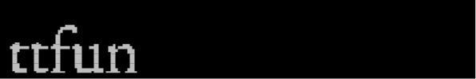

### Rescale `2x1`

```bash
ttfun -r 2x1
```


### Rescale `3x1`

```bash
ttfun -r 3x1
```


### Invert

```bash
ttfun -n
```


### Style `octant`

```bash
ttfun -S octant
```


> [!NOTE]
> This is the default style.

### Style `octant` inverted

```bash
ttfun -S octant -n
```


### Style `octant-sep`

```bash
ttfun -S octant-sep
```

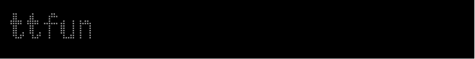

### Style `octant-sep` inverted

```bash
ttfun -S octant-sep -n
```

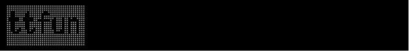

### Style `sextant`

```bash
ttfun -S sextant
```

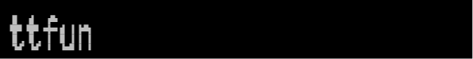

### Style `sextant` inverted

```bash
ttfun -S sextant -n
```

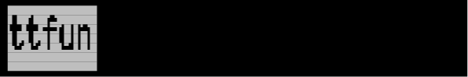

### Style `sextant-sep`

```bash
ttfun -S sextant-sep
```

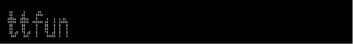

### Style `sextant-sep` inverted

```bash
ttfun -S sextant-sep -n
```

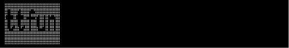

### Style `quadrant`

```bash
ttfun -S quadrant
```

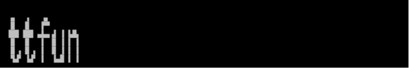

### Style `quadrant` inverted

```bash
ttfun -S quadrant -n
```

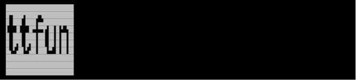

### Style `quadrant-sep`

```bash
ttfun -S quadrant-sep
```

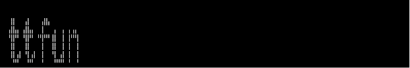

### Style `quadrant-sep` inverted

```bash
ttfun -S quadrant-sep -n
```

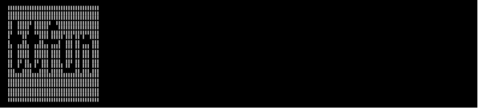

### Style `full`

```bash
ttfun -S full
```

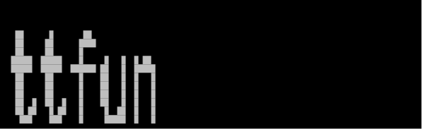

### Style `full` inverted

```bash
ttfun -S full -n
```

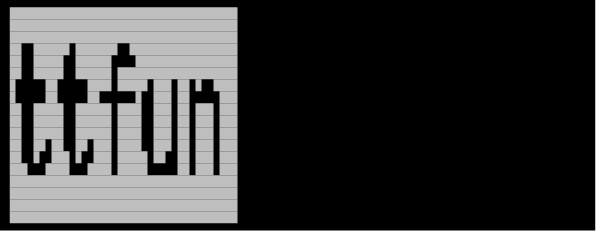

### Style `full-color`

```bash
ttfun -S full-color
```

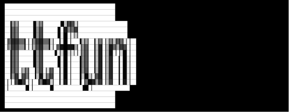

### Style `full-color` inverted

```bash
ttfun -S full-color -n
```

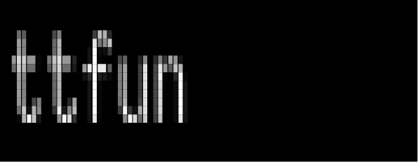

### Style `full-shade`

```bash
ttfun -S full-shade
```

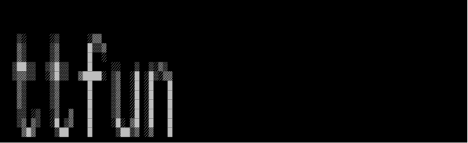

### Style `full-shade` inverted

```bash
ttfun -S full-shade -n
```

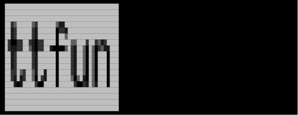

### Demo

```bash
ttfun -d
```

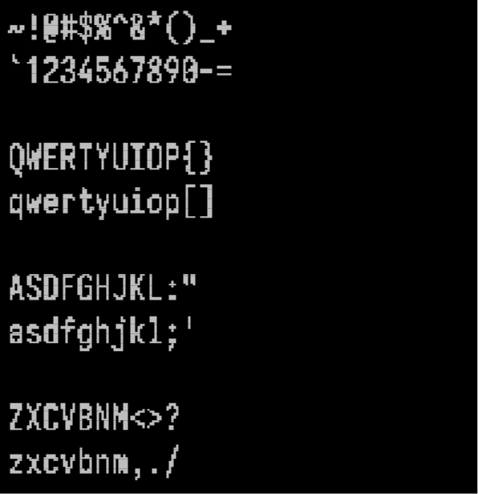

### Render `img/tree.webp`


---

```bash
ttfun -I img/tree.webp -r 0.25 -S octant-sep
```

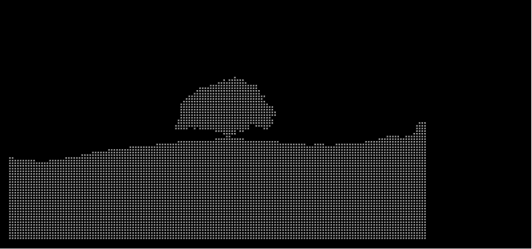

---

```bash
ttfun -I img/tree.webp -r 0.125x0.0625 -S full-color
```

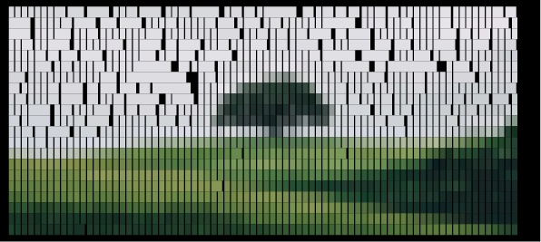

---

```bash
ttfun -I img/tree.webp -r 0.125x0.0625 -S full-color -n
```

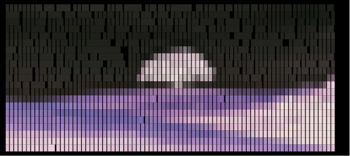

# Library

```rust
use ttfun::*;

// Render text to font image
let iosevka = FontArc::try_from_vec(IOSEVKA.to_vec()).expect("font");
let font_size = 18.0;
let padding = Padding::all(0);
let rescale = Rescale::parse("1").expect("rescale");
let img = text_to_image(
    "ttfun",
    &iosevka,
    font_size,
    &rescale,
    &padding,
)
.expect("image");

// Render font image to `full` style
let invert = false;
let threshold = 180;
let full_char = "\u{2588}";
let full = Style::Full.render(
    &img,
    invert,
    threshold,
    full_char,
)
.expect("render");

assert_eq!(
    full,
    "                                      
                                      
                                      
  ██      █       ██                  
  ██     ██      ████                 
  ██     ██      █                    
 █████  █████    █     █   █  █ ██    
 █████  █████  ██████ ██   █  █████   
  ██     ██      █    ██   █  █   █   
  ██     ██      █    ██   █  █   █   
  ██     ██      █    ██   █  █   █   
  ██  █  ██  █   █    ██   █  █   █   
  ██ ██   █ ██   █     █  ██  █   █   
   ███    ███    █     █████  █   █   
                                      
                                      
                                      
                                      
    ",
);
```

# Fonts

This crate includes the following unmodified fonts in its source code and embeds them in its binary
executable.

## EB Garamond

Copyright 2017 The EB Garamond Project Authors (<https://github.com/octaviopardo/EBGaramond12>)

This Font Software is licensed under the SIL Open Font License, Version 1.1.

## Iosevka

Copyright (c) 2015-2026, Renzhi Li (aka. Belleve Invis, <belleve@typeof.net>)

This Font Software is licensed under the SIL Open Font License, Version 1.1.

[Block Elements]:
https://www.unicode.org/Public/latest/charts/nameslist/2580/

[Braille Patterns]:
https://www.unicode.org/Public/latest/charts/nameslist/2800/

[Symbols for Legacy Computing]:
https://www.unicode.org/Public/latest/charts/nameslist/1fb00/

[Symbols for Legacy Computing Supplement]:
https://www.unicode.org/Public/latest/charts/nameslist/1cc00/

[`README-TERM.md`]:
README-TERM.md

[`resvg`]:
https://crates.io/crates/resvg

[`termframe`]:
https://github.com/pamburus/termframe

