# About

Render text and images to Unicode characters

# CLI

```bash
ttfun -h
```

```text
!run:../target/release/ttfun -h
```

```bash
ttfun --help
```

```text
!run:../target/release/ttfun --help
```

## Version

```bash
ttfun -V
```

```text
!run:../target/release/ttfun -V
```

## Examples

> [!WARNING]
> As of version `0.3.0`, the actual text outputs for the examples were moved to [`README-TERM.md`]
> and replaced with screenshot outputs captured via [`termframe`] and [`resvg`].
> While they are better than viewing unsupported Unicode text block characters and terminal color
> codes on a webpage, they still look a bit janky (slight gapping in all but it's especially bad in
> the full-color examples).
> For a pixel-perfect viewing experience, recommend viewing in terminal via `ttfun -R` or
> `bat -pl md README-TERM.md`.

```bash
ttfun
```

!run:termframe -o img/ttfun.svg --font-family Iosevka -W 80 -H auto --line-height 1 --window false -- ../target/release/ttfun 2>/dev/null
!run:resvg img/ttfun.svg img/ttfun.png
!run:rm img/ttfun.svg


### Font `eb-garamond` 36

```bash
ttfun -f eb-garamond -s 36
```

!run:termframe -o img/ttfun_-f_eb-garamond_-s_36.svg --font-family Iosevka -W 80 -H auto --line-height 1 --window false -- ../target/release/ttfun -f eb-garamond -s 36 2>/dev/null
!run:resvg img/ttfun_-f_eb-garamond_-s_36.svg img/ttfun_-f_eb-garamond_-s_36.png
!run:rm img/ttfun_-f_eb-garamond_-s_36.svg


### Rescale `2x1`

```bash
ttfun -r 2x1
```

!run:termframe -o img/ttfun_-r_2x1.svg --font-family Iosevka -W 80 -H auto --line-height 1 --window false -- ../target/release/ttfun -r 2x1 2>/dev/null
!run:resvg img/ttfun_-r_2x1.svg img/ttfun_-r_2x1.png
!run:rm img/ttfun_-r_2x1.svg


### Rescale `3x1`

```bash
ttfun -r 3x1
```

!run:termframe -o img/ttfun_-r_3x1.svg --font-family Iosevka -W 80 -H auto --line-height 1 --window false -- ../target/release/ttfun -r 3x1 2>/dev/null
!run:resvg img/ttfun_-r_3x1.svg img/ttfun_-r_3x1.png
!run:rm img/ttfun_-r_3x1.svg


### Invert

```bash
ttfun -n
```

!run:termframe -o img/ttfun_-n.svg --font-family Iosevka -W 80 -H auto --line-height 1 --window false -- ../target/release/ttfun -n 2>/dev/null
!run:resvg img/ttfun_-n.svg img/ttfun_-n.png
!run:rm img/ttfun_-n.svg


### Style `octant`

```bash
ttfun -S octant
```

!run:termframe -o img/ttfun_-S_octant.svg --font-family Iosevka -W 80 -H auto --line-height 1 --window false -- ../target/release/ttfun -S octant 2>/dev/null
!run:resvg img/ttfun_-S_octant.svg img/ttfun_-S_octant.png
!run:rm img/ttfun_-S_octant.svg


> [!NOTE]
> This is the default style.

### Style `octant` inverted

```bash
ttfun -S octant -n
```

!run:termframe -o img/ttfun_-S_octant_-n.svg --font-family Iosevka -W 80 -H auto --line-height 1 --window false -- ../target/release/ttfun -S octant -n 2>/dev/null
!run:resvg img/ttfun_-S_octant_-n.svg img/ttfun_-S_octant_-n.png
!run:rm img/ttfun_-S_octant_-n.svg


### Style `octant-sep`

```bash
ttfun -S octant-sep
```

!run:termframe -o img/ttfun_-S_octant-sep.svg --font-family Iosevka -W 80 -H auto --line-height 1 --window false -- ../target/release/ttfun -S octant-sep 2>/dev/null
!run:resvg img/ttfun_-S_octant-sep.svg img/ttfun_-S_octant-sep.png
!run:rm img/ttfun_-S_octant-sep.svg


### Style `octant-sep` inverted

```bash
ttfun -S octant-sep -n
```

!run:termframe -o img/ttfun_-S_octant-sep_-n.svg --font-family Iosevka -W 80 -H auto --line-height 1 --window false -- ../target/release/ttfun -S octant-sep -n 2>/dev/null
!run:resvg img/ttfun_-S_octant-sep_-n.svg img/ttfun_-S_octant-sep_-n.png
!run:rm img/ttfun_-S_octant-sep_-n.svg


### Style `sextant`

```bash
ttfun -S sextant
```

!run:termframe -o img/ttfun_-S_sextant.svg --font-family Iosevka -W 80 -H auto --line-height 1 --window false -- ../target/release/ttfun -S sextant 2>/dev/null
!run:resvg img/ttfun_-S_sextant.svg img/ttfun_-S_sextant.png
!run:rm img/ttfun_-S_sextant.svg
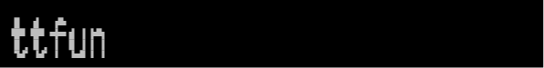

### Style `sextant` inverted

```bash
ttfun -S sextant -n
```

!run:termframe -o img/ttfun_-S_sextant_-n.svg --font-family Iosevka -W 80 -H auto --line-height 1 --window false -- ../target/release/ttfun -S sextant -n 2>/dev/null
!run:resvg img/ttfun_-S_sextant_-n.svg img/ttfun_-S_sextant_-n.png
!run:rm img/ttfun_-S_sextant_-n.svg


### Style `sextant-sep`

```bash
ttfun -S sextant-sep
```

!run:termframe -o img/ttfun_-S_sextant-sep.svg --font-family Iosevka -W 80 -H auto --line-height 1 --window false -- ../target/release/ttfun -S sextant-sep 2>/dev/null
!run:resvg img/ttfun_-S_sextant-sep.svg img/ttfun_-S_sextant-sep.png
!run:rm img/ttfun_-S_sextant-sep.svg


### Style `sextant-sep` inverted

```bash
ttfun -S sextant-sep -n
```

!run:termframe -o img/ttfun_-S_sextant-sep_-n.svg --font-family Iosevka -W 80 -H auto --line-height 1 --window false -- ../target/release/ttfun -S sextant-sep -n 2>/dev/null
!run:resvg img/ttfun_-S_sextant-sep_-n.svg img/ttfun_-S_sextant-sep_-n.png
!run:rm img/ttfun_-S_sextant-sep_-n.svg
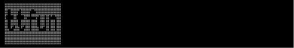

### Style `quadrant`

```bash
ttfun -S quadrant
```

!run:termframe -o img/ttfun_-S_quadrant.svg --font-family Iosevka -W 80 -H auto --line-height 1 --window false -- ../target/release/ttfun -S quadrant 2>/dev/null
!run:resvg img/ttfun_-S_quadrant.svg img/ttfun_-S_quadrant.png
!run:rm img/ttfun_-S_quadrant.svg
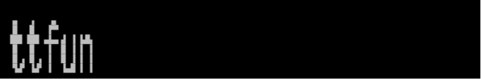

### Style `quadrant` inverted

```bash
ttfun -S quadrant -n
```

!run:termframe -o img/ttfun_-S_quadrant_-n.svg --font-family Iosevka -W 80 -H auto --line-height 1 --window false -- ../target/release/ttfun -S quadrant -n 2>/dev/null
!run:resvg img/ttfun_-S_quadrant_-n.svg img/ttfun_-S_quadrant_-n.png
!run:rm img/ttfun_-S_quadrant_-n.svg


### Style `quadrant-sep`

```bash
ttfun -S quadrant-sep
```

!run:termframe -o img/ttfun_-S_quadrant-sep.svg --font-family Iosevka -W 80 -H auto --line-height 1 --window false -- ../target/release/ttfun -S quadrant-sep 2>/dev/null
!run:resvg img/ttfun_-S_quadrant-sep.svg img/ttfun_-S_quadrant-sep.png
!run:rm img/ttfun_-S_quadrant-sep.svg
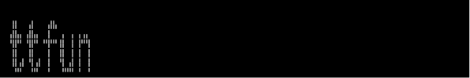

### Style `quadrant-sep` inverted

```bash
ttfun -S quadrant-sep -n
```

!run:termframe -o img/ttfun_-S_quadrant-sep_-n.svg --font-family Iosevka -W 80 -H auto --line-height 1 --window false -- ../target/release/ttfun -S quadrant-sep -n 2>/dev/null
!run:resvg img/ttfun_-S_quadrant-sep_-n.svg img/ttfun_-S_quadrant-sep_-n.png
!run:rm img/ttfun_-S_quadrant-sep_-n.svg
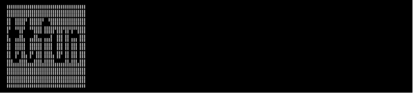

### Style `full`

```bash
ttfun -S full
```

!run:termframe -o img/ttfun_-S_full.svg --font-family Iosevka -W 80 -H auto --line-height 1 --window false -- ../target/release/ttfun -S full 2>/dev/null
!run:resvg img/ttfun_-S_full.svg img/ttfun_-S_full.png
!run:rm img/ttfun_-S_full.svg
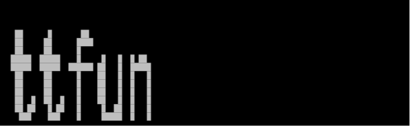

### Style `full` inverted

```bash
ttfun -S full -n
```

!run:termframe -o img/ttfun_-S_full_-n.svg --font-family Iosevka -W 80 -H auto --line-height 1 --window false -- ../target/release/ttfun -S full -n 2>/dev/null
!run:resvg img/ttfun_-S_full_-n.svg img/ttfun_-S_full_-n.png
!run:rm img/ttfun_-S_full_-n.svg


### Style `full-color`

```bash
ttfun -S full-color
```

!run:termframe -o img/ttfun_-S_full-color.svg --font-family Iosevka -W 80 -H auto --line-height 1 --window false -- ../target/release/ttfun -S full-color 2>/dev/null
!run:resvg img/ttfun_-S_full-color.svg img/ttfun_-S_full-color.png
!run:rm img/ttfun_-S_full-color.svg


### Style `full-color` inverted

```bash
ttfun -S full-color -n
```

!run:termframe -o img/ttfun_-S_full-color_-n.svg --font-family Iosevka -W 80 -H auto --line-height 1 --window false -- ../target/release/ttfun -S full-color -n 2>/dev/null
!run:resvg img/ttfun_-S_full-color_-n.svg img/ttfun_-S_full-color_-n.png
!run:rm img/ttfun_-S_full-color_-n.svg
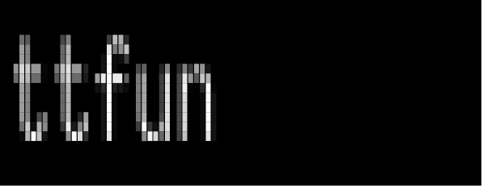

### Style `full-shade`

```bash
ttfun -S full-shade
```

!run:termframe -o img/ttfun_-S_full-shade.svg --font-family Iosevka -W 80 -H auto --line-height 1 --window false -- ../target/release/ttfun -S full-shade 2>/dev/null
!run:resvg img/ttfun_-S_full-shade.svg img/ttfun_-S_full-shade.png
!run:rm img/ttfun_-S_full-shade.svg


### Style `full-shade` inverted

```bash
ttfun -S full-shade -n
```

!run:termframe -o img/ttfun_-S_full-shade_-n.svg --font-family Iosevka -W 80 -H auto --line-height 1 --window false -- ../target/release/ttfun -S full-shade -n 2>/dev/null
!run:resvg img/ttfun_-S_full-shade_-n.svg img/ttfun_-S_full-shade_-n.png
!run:rm img/ttfun_-S_full-shade_-n.svg


### Demo

```bash
ttfun -d
```

!run:termframe -o img/ttfun_-d.svg --font-family Iosevka -W 80 -H auto --line-height 1 --window false -- ../target/release/ttfun -d 2>/dev/null
!run:resvg img/ttfun_-d.svg img/ttfun_-d.png
!run:rm img/ttfun_-d.svg
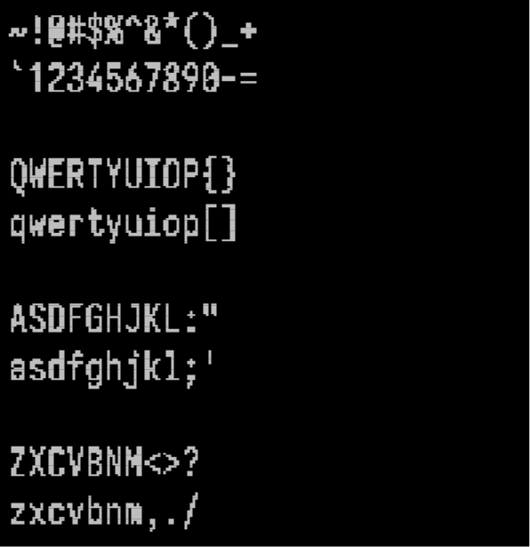

### Render `img/tree.webp`


---

```bash
ttfun -I img/tree.webp -r 0.25 -S octant-sep
```

!run:termframe -o img/ttfun_-I_tree_webp_-r_025_-S_octant-sep.svg --font-family Iosevka -W 80 -H auto --line-height 1 --window false -- ../target/release/ttfun -I ../img/tree.webp -r 0.25 -S octant-sep 2>/dev/null
!run:resvg img/ttfun_-I_tree_webp_-r_025_-S_octant-sep.svg img/ttfun_-I_tree_webp_-r_025_-S_octant-sep.png
!run:rm img/ttfun_-I_tree_webp_-r_025_-S_octant-sep.svg
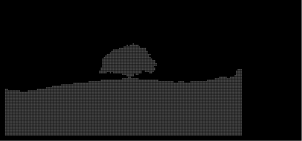

---

```bash
ttfun -I img/tree.webp -r 0.125x0.0625 -S full-color
```

!run:termframe -o img/ttfun_-I_tree_webp_-r_0125x00625_-S_full-color.svg --font-family Iosevka -W 80 -H auto --line-height 1 --window false -- ../target/release/ttfun -I ../img/tree.webp -r 0.125x0.0625 -S full-color 2>/dev/null
!run:resvg img/ttfun_-I_tree_webp_-r_0125x00625_-S_full-color.svg img/ttfun_-I_tree_webp_-r_0125x00625_-S_full-color.png
!run:rm img/ttfun_-I_tree_webp_-r_0125x00625_-S_full-color.svg
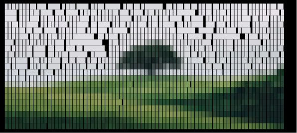

---

```bash
ttfun -I img/tree.webp -r 0.125x0.0625 -S full-color -n
```

!run:termframe -o img/ttfun_-I_tree_webp_-r_0125x00625_-S_full-color_-n.svg --font-family Iosevka -W 80 -H auto --line-height 1 --window false -- ../target/release/ttfun -I ../img/tree.webp -r 0.125x0.0625 -S full-color -n 2>/dev/null
!run:resvg img/ttfun_-I_tree_webp_-r_0125x00625_-S_full-color_-n.svg img/ttfun_-I_tree_webp_-r_0125x00625_-S_full-color_-n.png
!run:rm img/ttfun_-I_tree_webp_-r_0125x00625_-S_full-color_-n.svg
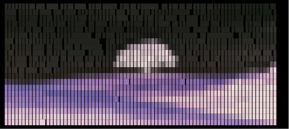

# Library

!inc:LIB.md

# Fonts

This crate includes the following unmodified fonts in its source code and embeds them in its binary
executable.

## EB Garamond

Copyright 2017 The EB Garamond Project Authors (<https://github.com/octaviopardo/EBGaramond12>)

This Font Software is licensed under the SIL Open Font License, Version 1.1.

## Iosevka

Copyright (c) 2015-2026, Renzhi Li (aka. Belleve Invis, <belleve@typeof.net>)

This Font Software is licensed under the SIL Open Font License, Version 1.1.

[Block Elements]:
https://www.unicode.org/Public/latest/charts/nameslist/2580/

[Braille Patterns]:
https://www.unicode.org/Public/latest/charts/nameslist/2800/

[Symbols for Legacy Computing]:
https://www.unicode.org/Public/latest/charts/nameslist/1fb00/

[Symbols for Legacy Computing Supplement]:
https://www.unicode.org/Public/latest/charts/nameslist/1cc00/

[`README-TERM.md`]:
README-TERM.md

[`resvg`]:
https://crates.io/crates/resvg

[`termframe`]:
https://github.com/pamburus/termframe

